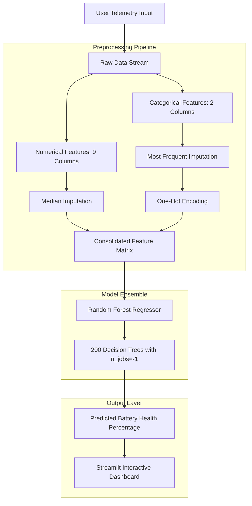

# Laptop Battery Health Predictor

An end-to-end machine learning system that estimates laptop battery degradation and remaining health percentage from daily operational habits, thermal stress, and charging telemetry.

<p align="center">
  
  
  
  
  
  
  
</p>

---

## Overview

Laptop batteries begin degrading the day they roll off the factory line. While operating systems typically report a simple health ratio based strictly on past charge capacity, they offer zero visibility into why that degradation happened or what your specific habits will do to your device over the next six months.

Battery wear is not just a function of age or cycle counts. Modern lithium-ion and lithium-polymer cells degrade due to a combination of electrochemical stress factors: sustained high operating temperatures, prolonged periods spent at high voltage (100% charge states), aggressive fast charging, and persistent thermal stress under heavy computing loads like gaming or video compilation.

This project uses an ensemble machine learning pipeline (Random Forest Regression) trained on 5,000 laptop usage records to capture these multi-variable degradation patterns. It provides users with an interactive, real-time web dashboard where they can input their device telemetry and immediately see their predicted battery health percentage alongside actionable degradation insights.

---

## System Architecture

The following diagram illustrates how user input moves from the web interface through data preprocessing and the model ensemble to generate the final battery health output:



---

## Key Features

- **Multi-Factor Degradation Modeling**: Evaluates 11 distinct hardware, environmental, and behavioral features instead of relying on battery cycles alone.
- **Production-Ready Pipeline**: Preprocessing (missing-value imputation and categorical encoding) and model inference are packaged into a single Scikit-Learn `Pipeline` object for zero data-leakage inference.
- **Interactive Web Interface**: Built with Streamlit to enable clean numeric inputs, dropdown selections, and instant prediction without touching the command line.
- **Ensemble Robustness**: Uses a 200-estimator Random Forest model that captures non-linear compounding effects (for example, the joint impact of high ambient temperature combined with high charge levels).

---

## Dataset and Feature Reference

The model is trained on a structured dataset comprising 5,000 laptop usage profiles. Each observation captures operational variables and the resulting measured battery health percentage.

| Feature Name | Type | Unit / Options | Physical and Chemical Relevance |
|---|---|---|---|
| `battery_cycles` | Numerical | Count | Number of full charge-discharge cycles completed; fundamental measure of cathode-anode wear. |
| `laptop_age_months` | Numerical | Months | Calendar age of the battery pack, accounting for passive chemical decomposition over time. |
| `avg_daily_usage_hours` | Numerical | Hours / Day | Active runtime per day, measuring the continuous duty cycle of the laptop. |
| `avg_charge_level_percent` | Numerical | Percentage (%) | Typical state of charge (SoC). Keeping cells at or near 100% voltage induces significant parasitic electrolyte degradation. |
| `charging_frequency_per_day` | Numerical | Count / Day | Frequency of plug-in events, reflecting micro-charging and shallow-cycling behavior. |
| `gaming_hours_per_week` | Numerical | Hours / Week | Weekly time spent under intensive GPU/CPU load, driving internal laptop chassis temperatures higher. |
| `avg_temperature_c` | Numerical | Celsius (°C) | Operating temperature of the battery. Elevated temperatures exponentially accelerate cell SEI layer growth. |
| `fast_charging_usage_percent` | Numerical | Percentage (%) | Proportion of charge cycles delivered via high-wattage fast charging, which generates localized internal heat. |
| `heavy_load_hours_per_week` | Numerical | Hours / Week | Hours devoted to CPU-bound workloads like rendering, virtualization, or data processing. |
| `battery_type` | Categorical | `Li-ion`, `Li-polymer` | Battery chemistry. Lithium-polymer cells differ in physical packaging and thermal dissipation from cylindrical or prismatic Lithium-ion cells. |
| `usage_pattern` | Categorical | `Light`, `Moderate`, `Heavy`, `Very Heavy` | Subjective classification of typical daily workflow intensity. |
| `battery_health_percent` | Target | Percentage (46.5% - 97.9%) | Measured ratio of current full-charge capacity to original designed factory capacity. |

---

## Machine Learning Methodology

### 1. Data Preprocessing
Data transformation is handled via `sklearn.compose.ColumnTransformer`:
- **Numeric Pipeline**: Applied to all 9 continuous variables using `SimpleImputer(strategy='median')` to guard against missing values while maintaining resistance to outliers.
- **Categorical Pipeline**: Applied to `battery_type` and `usage_pattern` using `SimpleImputer(strategy='most_frequent')` followed by `OneHotEncoder(handle_unknown='ignore')` to ensure incoming inputs never break the scoring engine.

### 2. Regression Algorithm
The core estimator is a `RandomForestRegressor` configured with:
- `n_estimators = 200`
- `random_state = 42`
- `n_jobs = -1` (parallelized across all available CPU cores)

Random Forest was chosen over standard linear regression because battery degradation is non-linear. For example, a 5°C increase in temperature causes vastly more damage when a laptop is charged at 100% than when stored at 50%. Tree-based ensembles naturally map these non-linear feature interactions without manual polynomial expansion.

---

## Repository Structure

```
battery_health_prediction/
│
├── battery_health_model.pkl            # Serialized Scikit-Learn Pipeline (Preprocessor + Random Forest)
├── feature_columns.pkl                 # Ordered list of training feature names
├── scaler.pkl                          # Additional scaling reference object
├── laptop_battery_health_prediction.csv # Full training dataset (5,000 records)
├── laptop_health.py                    # Streamlit web application script
├── requirements.txt                    # Project dependencies with version constraints
├── .gitignore                          # Standard Python environment and system exclusions
└── README.md                           # Comprehensive documentation
```

---

## Installation and Setup

### Prerequisites
- Python 3.10 or higher
- Git installed on your system

### 1. Clone the Repository
```bash
git clone https://github.com/mohitkumark1818-alt/battery_health_predictor.git
cd battery_health_predictor
```

### 2. Set Up a Virtual Environment (Recommended)
```bash
# Windows
python -m venv venv
venv\Scripts\activate

# macOS / Linux
python3 -m venv venv
source venv/bin/activate
```

### 3. Install Dependencies
```bash
pip install -r requirements.txt
```

### 4. Run the Application
```bash
streamlit run laptop_health.py
```

The Streamlit server will initialize and print local access URLs. Open your browser and navigate to:
```
http://localhost:8501
```

---

## Interpreting Health Predictions

Once you enter your metrics and click **Predict Battery Health**, the model computes your device's expected health score. Here is how to evaluate the results:

| Health Range | Assessment | Recommended Action |
|---|---|---|
| **90% - 100%** | Pristine / Like New | Keep following standard charging practices. |
| **80% - 89%** | Good Operational Condition | Normal degradation for a device under 2 years old. Enable battery threshold limiting (e.g., 80% ceiling) if your OEM software supports it. |
| **70% - 79%** | Moderate Degradation | Battery runtime will feel noticeably reduced on mobile workloads. Avoid gaming or heavy compilation on battery power alone. |
| **Below 70%** | Advanced Wear | Cell capacity has dropped significantly. Consider replacing the battery pack if portability is critical to your workflow. |

---

## Author

**Mohit Kumawat**
- GitHub: [@mohitkumark1818-alt](https://github.com/mohitkumark1818-alt)
- Email: mohitkumark1818@gmail.com
